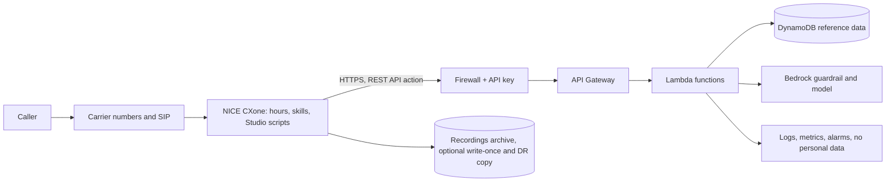

# NICE CXone enterprise insurance lab (large insurer, telco carrier)

A **lab** that shows how to design, build, test and migrate to NICE CXone for a large Australian general insurer, with a carrier in the middle and strict regulation around it. Everything is fictional ("Kestrel Insurance"). It is for learning and for interview discussion. It is not a customer deliverable and it has not been run against a customer tenant.

## What is here



| Folder | What it holds |
|---|---|
| `cxone/config/` | The CXone setup as data: skills, teams, hours, dispositions, codes, points of contact |
| `cxone/studio/` | Six reviewed Studio script designs (YAML) with a reason on every important step |
| `cxone/endpoints.json` | Every CXone API path in one place, each marked unverified until you test it |
| `openapi/`, `postman/` | The contract between Studio and the AWS layer |
| `terraform/` | OpenTofu/Terraform for the AWS side (7 modules, 3 environments) |
| `app/` | The Lambda code and 87 unit tests (no AWS needed) |
| `scripts/bash/`, `scripts/powershell/` | The same 15 scripts in two languages |
| `scripts/tests/` | A local mock of CXone and the API, so the scripts can be tested offline |
| `evals/`, `tools/` | AI guard test prompts, the repo checker, and tests for the checker |
| `migration/` | Number inventory, Cisco-to-CXone mapping, 45 test cases, waves, cutover and roll-back |
| `governance/`, `carrier/` | Compliance matrix, threat model, incident clocks, provider register, carrier checklist |
| `docs/` | The manuals: build, runbooks, architecture brief |

## Why it is built this way (the short version)

1. **CXone has no Terraform provider that I could find.** So the AWS side is infrastructure as code, and the CXone side is **configuration as code**: reviewed data files plus scripts that create what is missing and never delete anything they did not create.
2. **Fail the safe way.** Anything that guards money or personal data fails closed to a person. Anything that only adds priority fails open.
3. **No personal data in logs, by code and by test.**
4. **The carrier is the cutover control.** Roll-back is a rehearsed carrier change.
5. **AI is an extra, never a gate.** Every AI path ends at a person. The guard checks both what goes in and what comes out.

Read `docs/ARCHITECTURE.md` for the full reasoning.

## Quick start (read-only first)

```bash
python3 tools/check_repo.py                 # repo checks, no accounts needed
python3 -m pytest app -q                    # 87 function tests, no AWS needed
python3 tools/run_ai_eval.py                # AI guard prompts, local layer
bash scripts/tests/test_cxone_scripts.sh bash   # scripts against the local mock
```

To use it for real, follow `docs/RUNBOOK-BASH.md` or `docs/RUNBOOK-POWERSHELL.md`. **Use a lab tenant and a lab AWS account only.**

## Honest limits

- Not applied to any real CXone tenant or AWS account. The CXone paths and field names in `cxone/endpoints.json` and the script body builders were written from the documentation pattern and **must be checked** with `01-verify-endpoints` before the first apply.
- The Terraform was checked for formatting, structure and cross-references here; the full `tofu validate` (which needs the AWS provider) runs in CI.
- The Studio files are **designs** (reviewed, linted, and used as the source of truth), not exported Studio scripts. You rebuild them in Studio from the designs.
- Compliance statements marked "verify" were not checked against current source text.
- The Bedrock guardrail test cases that need a deployed guardrail are reported as skipped offline, never as passed.

## Cost and clean-up

See `docs/OPERATIONS-COST-CLEANUP.md`. Short version: the minimal environment is cheap but not free (firewall, logs, and any Bedrock use cost money). Tear down with `19-aws-destroy` and `09-cxone-destroy`, then check billing.

## Licence

MIT. Fictional data only.
