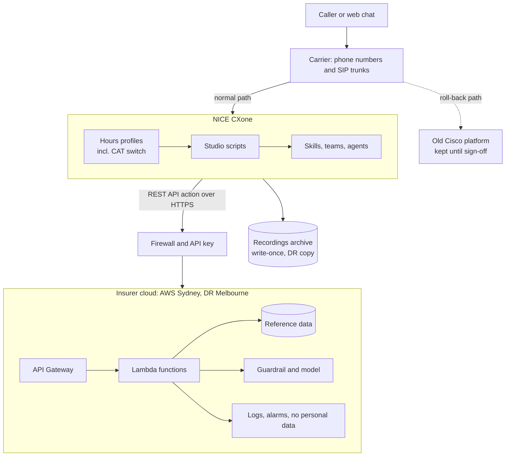
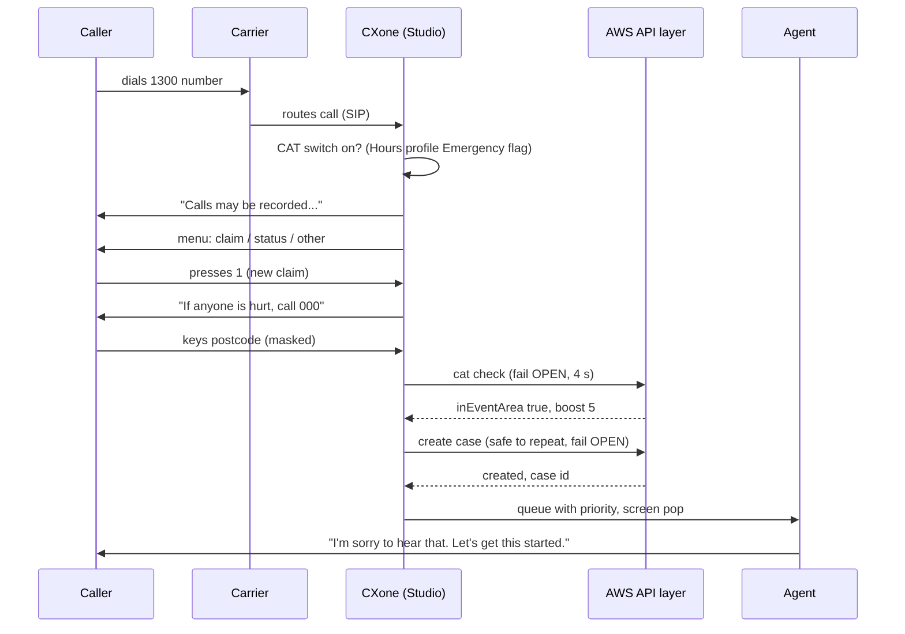
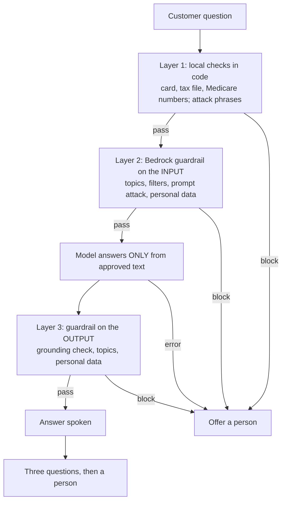
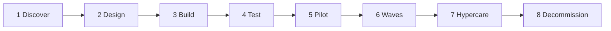

# Architecture: moving a large insurer's contact centre from Cisco to NICE CXone

A lab design. The company, numbers, customers and data are fictional ("Kestrel Insurance"). Nothing here was run on a real customer system. Statements about regulation are marked **(verify)** where they were not checked against the current source text.

---

## 1. The picture on one page

**Read it from the top down.** A caller dials a number. The carrier decides where that number rings: CXone (normal) or Cisco (the way back). CXone checks the hours, runs a Studio script (the call flow), and uses skills and teams to find an agent. When a script needs a fact (is this policy real? is this postcode in a storm zone?) it makes a small web call into the insurer's own cloud, through a firewall. The answer comes back in under a few seconds, or the script takes the safe path and offers a person.

---

## 2. Five ideas that explain most of it

1. **The carrier owns the cutover switch.** Moving a phone number between platforms is a carrier change. So moving forward and moving back are the same kind of action. That makes roll-back real, not a hope.
2. **CXone is configured, not coded.** Most of the platform is settings (skills, teams, hours) plus call flows drawn in Studio. There is no official Terraform provider for CXone that I could find. So the CXone side is **configuration as code**: reviewed data files, and scripts that create what is missing and never delete what they did not create.
3. **Fail the safe way, and decide the safe way per step.** If the lookup that guards money fails, treat the caller as *not verified* and offer a person (fail **closed**). If the lookup only adds priority (storm area), carry on at normal priority (fail **open**). Every web call in a script must say which.
4. **The AI is an extra, never a gate.** Every AI path ends at a person. The guard checks what goes in and what comes out. If the guard breaks, the answer is "no".
5. **Prove it, do not claim it.** Tests, a checker that has been seen to fail, evidence files, and honest labels for what is only a design.

---

## 4. Cisco and NICE CXone, side by side (the "both setups")

The job is to move calls from the old world to the new one. You must be able to draw both. Here they are in plain words.

### 4.1 The Cisco source (two possibilities, and you must find out which)

Your own notes say it is **not yet known** whether the source is the classic on-premises stack (UCCE and CVP) or Webex Contact Center. The first question on day one is: *which is it?* This table covers both.

| Job | Classic on-premises stack | Webex Contact Center (cloud) |
|---|---|---|
| Call control (phones, trunks) | Cisco Unified Communications Manager (CUCM), voice gateways, CUBE border control | Cloud calling via carrier or Webex Calling or BYO PSTN |
| Routing brain | Unified CCE (UCCE): Router, Logger, Peripheral Gateways, routing scripts | Cloud routing with Flow Designer |
| IVR | Customer Voice Portal (CVP): Call Server, VXML Server, Media Server | Flow Designer plus voice/IVR nodes |
| Agent screen | Finesse desktop with gadgets | Webex CC Agent Desktop |
| Reporting | Unified Intelligence Center (CUIC), historical database | Analyzer and exports |
| Digital | Email and Chat product (ECE) or other | Webex Connect and digital channels |
| Recording | Recording via gateway/CUBE forking, or MediaSense-style, or a third-party recorder | Native or partner recording |

*(Verify the exact product names and versions in the real estate in discovery. Vendors rename products often.)*

### 4.2 The NICE CXone target

| Job | CXone piece |
|---|---|
| Tenant and organisation | Business unit, with divisions and roles |
| Phone numbers into the platform | Points of contact (PoC), carried by SIP trunks through the carrier or the platform's own telephony (verify which option the insurer chooses) |
| Opening hours, holidays, emergency switch | Hours of operation profiles (the CAT switch is a flag on one profile) |
| Call flow | Studio scripts: Play, Menu, Capture, Hours, REST API, Case, Snippet, Reqagent, QueueCallback |
| Who answers | Skills (queues), teams, proficiency |
| Agent screen | The CXone agent application, with screen pop and CRM embedding |
| Quality and workforce | Quality management, workforce management |
| AI | AI agents for self-service, knowledge AI, agent copilot, Enlighten analytics (section 7) |
| Reports and exports | Built-in reporting and data exports |

### 4.3 Concept map (the "translation table" you will use in meetings)

| Cisco says | CXone says | Trap |
|---|---|---|
| Dialed number + call type + routing script | Point of contact + Studio script | Rebuild from the *requirement*, not from the old flow |
| Skill group / precision queue | Skill + team membership with proficiency | CXone proficiency: lower number is better (verify in tenant) |
| CVP application / VXML | Studio actions | Prompts need re-recording or re-encoding |
| External VXML / database dip | REST API action | 10 s default timeout, 32 KB reply, 2 automatic retries: make writes safe to repeat |
| Time-of-day node | Hours profile and the Hours action | A missing holiday means the line is *open* on a public holiday |
| Emergency flag | Emergency flag on an Hours profile | One flag moves every line: drill it |
| Finesse gadget | Agent app features / embedded apps | Gadgets do not move: inventory every one |
| CUIC reports | CXone reports | History does not move; agree report definitions first |

The full 15-row table is in `migration/cisco-to-cxone-mapping.csv`.

---

## 5. How a call flows, in order

Three things to point at when you explain this:

- The **storm-area lookup fails open**. If our API is down the caller still gets in line (normal priority).
- The **case creation is safe to repeat**. CXone retries a failed web call twice on its own; the case id comes from a key, so two tries make one case.
- The **summary text is fixed in Studio**, not typed by the caller, so personal data cannot leak into a CRM note from this step.

---

## 6. The build, piece by piece, and why each piece exists

For each piece: what it is, **why it is built that way**, and what to say if challenged.

### 6.1 CXone setup as data (`cxone/config/*.json`)

- **What:** skills, teams, hours profiles, holidays, dispositions, unavailable codes and points of contact, written as JSON and checked against schemas.
- **Why:** a contact centre platform changes all the time. If the setup lives only in screens, nobody can review a change, compare two environments, or rebuild after a mistake. As data it can be reviewed in a pull request, checked by a program, and applied the same way every time.
- **Why not Terraform here:** I could not find an official Terraform provider for CXone. A community or home-made one would be a risk to put in front of an insurer. So the scripts talk to CXone's admin API directly. The scripts only **create what is missing**. They never update or delete what already exists, and delete only objects that are named in the config **and** carry a lab marker in their description.
- **If challenged ("so it's not real infrastructure as code?"):** "It is configuration as code with the same discipline: version control, review, repeatable apply, a plan step that shows what would change. The honest difference is it creates but does not reconcile drift. For production I would either use a supported provider if one exists by then, or add a read-compare step."

### 6.2 Studio scripts as reviewed designs (`cxone/studio/*.yaml`)

- **What:** six designs: `front_door`, `verify_caller`, `claims_self_service`, `cat_surge`, `care_path`, `ai_assist`. Each step has a type, its settings, and a `why`.
- **Why:** Studio scripts are drawn on a canvas. You cannot code-review a picture. A text design can be reviewed, linted by a program, and used as the instructions for building and testing the real script. The checker enforces rules such as: every web call has a timeout of 8 seconds or less, every web call states fail-open or fail-closed, every menu timeout ends at a person, keypad capture of sensitive values is masked, spoken text never uses a sensitive variable, no step is unreachable, and every path can end.
- **What it is not:** it is not an exported Studio script. You rebuild each from the design, then export and keep the export as the artefact. Say this plainly.
- **Why one script for many numbers:** the point of contact passes `brandName` and `line` as parameters. Eight numbers, one `front_door`; the care line and the CAT hotline are just two more values of `line`. Fewer scripts means fewer places for a bug.

### 6.3 The integration layer on AWS (API Gateway, Lambda, DynamoDB)

- **What:** seven small web endpoints: policy verify, claim status, case create, CAT check, guard, AI answer, health.
- **Why not do it inside Studio?** Studio can call a web service and hold small scripts. It is a poor place for business rules: limited testing, limited secrets handling, no unit tests, and logic you cannot reuse for chat. A small, tested service is easier to secure, test, monitor and change.
- **Why Lambda and DynamoDB?** Small, spiky, stateless calls suit serverless. DynamoDB is fast, cheap at this size and encrypted with your own key. In production the *source of truth* is the insurer's policy and claims systems; this layer would call them, or hold a read model. The lab uses fictional seed data.
- **Contract first:** `openapi/kestrel-cxone-api.yaml` is the agreement. A checker fails the build if Terraform routes and the contract disagree.

### 6.4 Two-factor verification, with one answer for every failure

- **What:** a caller proves they own the policy by keypad: policy number **and** postcode.
- **Why two factors:** a policy number alone is guessable. Two shared facts is weak but proportionate for reading a premium or claim status (not for changing bank details; that would need stronger proof).
- **Why the same answer for "no such policy" and "wrong postcode":** so the service cannot be used to find out which policies exist.
- **Why lock-outs count unknown numbers:** if only real numbers could be locked, the lock itself would reveal which numbers are real.
- **Why the keypad, not speech:** digits typed are not in a transcript, and they can be masked. Speech to text can put a number in a log.

### 6.5 Safe to repeat (idempotent writes)

- **What:** the case id is made from a key built from the contact id.
- **Why:** Studio retries a failed web call twice on its own. Without this, one timeout could make three cases and three callbacks.
- **Test:** send the same key twice. The second reply says `duplicate` with the same id.

### 6.6 Fail open or fail closed, per step

| Step | Mode | Reason |
|---|---|---|
| Policy / claim verify | **Closed** | If we cannot check, we must not assume yes. Caller goes to a person |
| AI guard and AI answer | **Closed** | An unchecked AI answer is worse than none |
| CAT check | **Open** | It only adds priority. A failure must not penalise a customer in a storm |
| Case create | **Open** | The call must continue. Agent can create the case by hand; the key makes replay safe |

The checker refuses a web call step that does not choose one.

### 6.7 The catastrophe switch

- **What:** one hours profile never closes; its *Emergency* flag is the switch. When on, every line runs the CAT script.
- **Why a flag and not a script edit:** in a storm you do not want to edit and publish scripts. A flag is one change, quick to set, quick to undo, and easy to audit.
- **How it is run:** `06-cat-mode on` asks you to type `ON`, sets the flag, reads it back, and prints the time. You then make a live call to confirm.
- **What changes for callers:** an honest message about volumes, the safety line first (call 000), a pointer to the website, a CAT queue, and an early callback offer after 90 seconds.

### 6.8 The care route

- **What:** a line with no menu and no verification. A person answers.
- **Why:** a customer in hardship, or after a disaster, should not face a quiz. Verification is done by a person, with judgment. Claims flagged for care are routed to the care team without the customer asking.
- **Link to the rulebook:** the insurance code of practice expects extra care for vulnerable customers and hardship (verify the current wording).

### 6.9 Recordings and the archive

- **What:** call recording is a CXone feature. The archive bucket is optional extra storage on AWS: encrypted with your own key, versioned, access-logged, optionally write-once (Object Lock) and copied to Melbourne.
- **Why write-once:** if the insurer must keep recordings untouched for a set time, "cannot be deleted or altered until the date" is a strong control. **Caution:** Object Lock is set when the bucket is made and locked objects cannot be deleted, so it is off in the lab and must be a deliberate decision in production.

### 6.10 Observability

- **What:** structured logs (no personal data), metric filters, alarms (function errors, throttles, slow responses, API 5xx errors, firewall blocks, guard blocks and guard errors, verification lock-outs), and a dashboard.
- **Why:** you can only run what you can see. The alarms on guard errors, verification lock-outs and function errors are the early warning that something upstream broke: a jump in lock-outs can mean a keypad problem or an attack, and a jump in guard errors means the AI path is failing closed.
- **Why no personal data in logs:** logs are copied, searched and kept. If they hold no personal data they are far less risky. The `log()` function only accepts named safe fields, and tests search the output.

### 6.11 Disaster recovery

- **What:** primary in Sydney, DR in Melbourne. The lab replicates the archive; a full second stack is a design option using the same modules.
- **Why two Australian regions:** resilience without sending data overseas.
- **Also:** the real DR switch for calls is at the **carrier**, because that is where the number is pointed.

### 6.12 Environments and promotion

- Three Terraform environments: `minimal`, `full`, `nonprod`. Promote the **same code** with different variable files.
- In CXone: build in a development stage, test, promote to production through change control. Scripts are exported and stored.
- **Rule:** never test on the production phone numbers except in a planned cutover.

### 6.13 Scripts that are safe to run

- Preflight prints which tenant and account you are on. Apply asks you to **retype the tenant name**, then type `YES`.
- Secrets come only from environment variables. The scripts never print a secret, a token or an API key; tests check that.
- Destroy deletes only objects that are named in the config and carry the lab marker.
- Every script is written twice (Bash and PowerShell) and both are tested against the same mock with the same checks.

### 6.14 The repo checker, and why it was attacked on purpose

`tools/check_repo.py` looks for secrets, state files, bad names, broken cross-references and unsafe Studio designs. A checker that never fails proves nothing, so `tools/test_check_repo.py` breaks the repo in 17 different ways and demands that the checker notice every time.

---

## 7. AI, generative AI, conversational AI and guardrails: AWS and NICE side by side

### 7.1 Three kinds of AI, in plain words

| Kind | What it does | Best used for | Risk |
|---|---|---|---|
| **Conversational AI (intent-based)** | Works out what the caller wants from a fixed list of intents, then follows a fixed flow | Transactions: check a claim, change an address | Misses unusual phrasing |
| **Generative AI (large language model)** | Writes a fresh answer from the question and some supplied text | General questions: "what do I need to lodge a claim?" | Can make things up, be tricked, or say what it must not |
| **Analytics / assist AI** | Listens or reads and helps people: summaries, next steps, scoring | Agent copilot, auto quality checks | Wrong summaries; privacy of recordings |

**The rule in this design:** use fixed flows for anything that touches money or personal data; use generative AI only for general questions answered from approved text; keep a person one step away.

### 7.2 Layers of safety (what is built)

| Layer | Built? | Where | Tested how |
|---|---|---|---|
| 0. Design: AI never decides, never handles policy numbers | Designed | `ai_assist.yaml`, `knowledge.txt` | Reviewed; linter rules |
| 1. Local checks (valid card, tax file, Medicare numbers by checksum; attack phrases) | **Built** | `guard_gateway` | Unit tests; 13 offline eval cases |
| 2/3. Bedrock guardrail: four denied topics, content filters at high strength, prompt-attack filter, personal-data rules, profanity list, grounding and relevance checks | **Built** (Terraform) | `modules/guardrail` | 9 online eval cases (need a deployed guardrail; **skipped offline, never counted as passed**) |
| 4. Model settings: low temperature, small answer limit, approved-text system prompt | **Built** | `ai_answer` | Unit tests with a fake model |
| 5. Fail closed on any error | **Built** | both functions | Unit tests |
| 6. Person always available; 3-turn limit | Designed (Studio) | `ai_assist.yaml` | Linter; manual test |
| 7. Monitoring of blocks, guard errors and lock-outs | **Built** | `modules/observability` | Alarm test in the test plan |

**Pinned version:** the guardrail is published as a numbered version and the function is pinned to it, so what was tested is what runs. A change means a new version, a re-run of the eval set, and a deliberate switch.

### 7.3 AWS and NICE, matched

| Need | AWS | NICE CXone | Honest note |
|---|---|---|---|
| Large language models | Bedrock foundation models | AI Agent Studio uses large language models; NICE describes it as model-flexible, including Amazon Bedrock (verify the current list in your tenant) | You can keep your own gateway and still use CXone Studio |
| Answers from your own documents | Bedrock Knowledge Bases | Knowledge AI | Both: keep the source documents approved and versioned |
| **Guardrails** | **Bedrock Guardrails** (topics, filters, personal data, grounding), callable by `ApplyGuardrail` independently of the model | Built-in safety instructions, grounding and escalation in AI agents; configured as part of the AI agent, not a standalone service I could find | **No exact one-to-one.** The vendor's controls are theirs to tune. If you must prove *your* rules to an auditor, calling your own guardrail from Studio (as this lab does) gives you the evidence |
| Chatbots for fixed intents | Amazon Lex | Virtual agent integration (for example connecting Lex or other bot platforms) and AI agents | Lex in your estate stays usable (verify supported connectors) |
| Analytics on calls | Contact Lens | Enlighten analytics | Check how recordings are processed and where |
| Agent assist | Amazon Q in Connect | Agent copilot | Same question: what data does it see? |
| Speech to text / text to speech | Transcribe / Polly | Built-in speech services (verify languages and accents) | Test with real Australian accents and noisy lines |
| Audit trail | CloudTrail, CloudWatch | Audit logs and reports in CXone, plus your own logs | Keep both |

### 7.4 What to say about Bedrock and CXone together

"In this design, CXone Studio calls a small guard service I control. That service applies a Bedrock guardrail to the question, calls the model with only approved text, and applies the guardrail again to the answer. NICE's own AI agents have built-in safety settings, and I would use them where they meet the policy. But where an auditor needs to see exactly which rules ran and which version, I like to keep that in a layer the insurer owns. The cost is more to run. The benefit is evidence."

### 7.5 Compliance touches on the AI

- **Automated decisions:** the AI only answers general questions. It does not decide claims or prices. Privacy rules due to start in December 2026 ask organisations to be open about certain automated decisions (verify the final wording). Say so in the privacy policy and on the call.
- **Where the model runs:** some Bedrock model options use cross-region inference, which may process data outside Australia. The Terraform variable warns about this. Check data residency before enabling.
- **Records:** keep the eval set, results and guardrail version for each release.
- **Testing for bias and harm:** include test prompts about vulnerable customers, disability and language. Review blocks that hit ordinary customers.

### 7.6 The gap, said honestly

- I built the guardrail and the guard service. I could not deploy and test the Bedrock layer here, so those 9 test cases are written but not run.
- I did not build a NICE AI Agent. I know what it is and where it fits. To close this gap: "I'd configure it in the lab tenant and run the same fixed question set against it."

---

## 8. Security and compliance: how the rules touch the design

An insurer is not a government agency, but it holds personal, financial and sometimes health information, and its regulators expect strong controls. Where a customer asks for "government-like" strictness, treat that as: encrypt everything, least privilege, prove it, and keep records. (Some customers go further and ask for services assessed under government security frameworks. Ask early whether that applies; it can limit which services and regions you may use. Verify.)

### 8.1 Controls, layer by layer

| Layer | Control | Where |
|---|---|---|
| Caller | Recording notice first; keypad capture for numbers; masked | `front_door.yaml`, `verify_caller.yaml` |
| Carrier | Number control, capacity, fraud limits, change tickets | `carrier/README.md` |
| CXone | Roles and divisions; named admin accounts; separate lab and production tenants; script change control | Process |
| Edge | Firewall with default block and an allow-list of the platform's addresses; API key; throttling | `modules/integration` |
| Application | Input checks on every field; same answer for every failure; lock-out; safe to repeat; no personal data in logs | `app/api`, 87 tests |
| Data | Encryption with a customer-managed key; versioned, access-logged archive; optional write-once | `modules/data`, `modules/recordings` |
| AI | Local checks, guardrail both ways, approved text only, fail closed, person always reachable | section 7 |
| Operations | Alarms, dashboard, evidence export, rehearsed roll-back and DR | `modules/observability`, `07-evidence-export` |
| Repo | Secret scan, state-file ban, checker self-tests, CI | `tools/` |

### 8.2 Compliance map (names to know; confirm current wording before relying on any)

| Area | What to say in one line |
|---|---|
| **APRA CPS 230** Operational Risk Management (in force from 1 July 2025) | "The contact centre is a critical operation. We set tolerance levels, keep a register of material service providers, rehearse continuity, and have notification clocks: 72 hours for material incidents, 24 hours when the continuity plan is activated, and 20 business days to tell APRA about a new or materially changed material provider agreement." **(verify each against the standard)** |
| **APRA CPS 234** Information Security | "Controls in proportion to the sensitivity of the information, including at providers, tested regularly, with incident notification." **(verify)** |
| **Privacy Act and APPs** | "Collect only what you need, tell people, secure it, limit use. The design keeps numbers out of logs and AI, uses fixed-text case summaries and a recording notice." |
| **APP 8** (overseas disclosure) | "Know where data is stored and processed, including vendor AI features. Ask vendors in writing." **(verify)** |
| **Automated decision-making transparency** (December 2026) | "Our AI does not decide. We still say so." **(verify final wording)** |
| **Notifiable Data Breaches** | "Assess quickly; notify when required." |
| **PCI DSS** | "Cards are not taken in the lab. For real payments, mask digits or pause recording so the agent and the recording never hold them, or use a payment IVR." **(verify the version)** |
| **General Insurance Code of Practice** | "Care for vulnerable customers, hardship, timely service. The care route, callbacks and CAT mode serve this." **(verify)** |
| **ASIC complaints handling (RG 271)** | "Complaints queue, disposition and tracking." **(verify)** |
| **Recording laws** | "Notify callers. Protect recordings." **(verify state rules)** |
| **NZ operations** | "NZ Privacy Act principles apply; check cross-border rules." **(verify)** |

More detail: `governance/compliance-matrix.md`, `governance/threat-model.md`, `governance/incident-runbook.md`.

### 8.3 Strict-environment habits

- Separate accounts: one for lab, one for production. Never the same.
- No shared logins. Every change has a name against it.
- Secrets never in files, chat or screenshots. Keys rotate.
- Evidence is a by-product of the work, not a project at the end.
- Written approval to change phone numbers.
- Test the roll-back at least as hard as the cutover.

---

## 9. The migration procedure on one page

Full detail: `docs/MIGRATION-PROCEDURE.md` and the `migration/` folder.

Discover = inventory every number, flow, report and integration. Design = requirements, not copies of old flows. Test = 45 cases, load, DR and a roll-back rehearsal. Pilot = wave 1, the lowest-risk number. Decommission = a separate decision.

**Five rules to remember**

1. **Inventory first.** Every number, call flow, report, gadget, integration, recording rule and who uses it. What you miss becomes a Monday-morning incident.
2. **Rebuild from the requirement.** Old flows hide forty years of workarounds. Ask what the business needs, then build that.
3. **Move one number at a time, safest first.** Wave 1 is the low-volume CAT hotline, which also proves the storm switch.
4. **The carrier is the switch.** Roll-back is a rehearsed call to the carrier. Write down the maximum roll-back time.
5. **Cisco stays alive until the business says otherwise.** For roll-back and for old recordings and reports.

**Parallel running:** you cannot have one number ring two platforms at once. Parallel proof comes from test numbers on the same trunks, from low-risk lines first, from comparing daily numbers, and from shadow sessions with agents. Be careful using the phrase "parallel run" without saying what was run in parallel.

---

## 10. How to improve service at a very large insurer (ideas with a measure)

Say the measure first. A good improvement has a number it moves.

| # | Idea | Why it helps | Measure | Watch out for |
|---|---|---|---|---|
| 1 | **Storm mode** (the CAT switch, early callback, event message, web pointer) | Large spikes break normal staffing; honesty and callbacks reduce anger | Abandon rate, average speed of answer, callback completion, complaints during events | Must be rehearsed; callbacks must be honoured |
| 2 | **Priority by affected postcode** | Customers in the damaged area need us first | Time to first contact for affected postcodes | Do not delay everyone else |
| 3 | **Care route with no hurdles** | Vulnerable customers should not face a quiz | Time to a care agent; care complaints; repeat contacts | Staffing the care team for events |
| 4 | **Status read-back for claims** | A large share of calls are "where is my claim?" | Containment of status calls; repeat contact rate; claim handler time saved | Read only approved fields; never promise dates |
| 5 | **Cut repeat verification** (verify once in the IVR, pass the result to the agent screen) | Customers hate being asked twice | Average handle time; "asked twice" survey item | Fail closed; keep lock-outs |
| 6 | **Agent assist at first notice of loss** (suggested questions, auto summary) | Shorter, better-quality lodgements and after-call work | After-call work time; first-time-right claim files | Check summary accuracy; keep a human in charge |
| 7 | **Menu tuning from data** | Too many options cause pressing 0 | Menu abandonment, 0-press rate, mis-transfer rate | Change one thing at a time |
| 8 | **Digital first for easy status and documents; phone for complex** | Frees phone agents for emotional, complex calls | Digital completion rate, phone containment, satisfaction | Do not trap people in a bot |
| 9 | **Automated quality sampling on every call** | Quality teams review a tiny share of calls today | Share of calls scored; coaching actions; QA agreement with humans | Fairness and privacy; explain it to staff |
| 10 | **Forecasting with event scenarios** | Staffing is planned on normal weeks | Forecast accuracy; service level in events | Needs clean history |
| 11 | **Right-skilling** (language and complexity skills) | The right agent first time | First-contact resolution; transfers per call | Do not over-split queues |
| 12 | **Proactive outreach after an event** (opt-in) | Contact before they have to call | Inbound volume reduction; satisfaction | Consent and calling-hours rules |

**Measures glossary:** first-contact resolution (FCR) = share of issues solved on the first contact. Average handle time (AHT) = talk + hold + after-call work. Service level = share answered within a target time. Abandon rate = share who hang up before an answer. Containment = share finished in self-service without an agent.

---

## 14. Glossary

| Word | Plain meaning |
|---|---|
| ACD | Automatic call distribution: the engine that matches callers to agents |
| ACW | After-call work: notes and wrap-up after a call |
| AHT | Average handle time |
| APRA | Australian Prudential Regulation Authority |
| ASA | Average speed of answer |
| BYOC | Bring your own carrier |
| CAT | Catastrophe: a severe weather or similar event that causes a surge of claims |
| CCaaS | Contact centre as a service |
| CPS 230 / CPS 234 | APRA standards on operational risk and on information security |
| CVP | Cisco Customer Voice Portal (IVR) |
| DR | Disaster recovery |
| DTMF | The tones made by phone keys |
| Fail closed / open | If a check cannot run: treat as "no" / treat as "carry on" |
| FNOL | First notice of loss: the first call to lodge a claim |
| Guardrail | Rules that check what goes into and out of an AI model |
| Idempotent | Safe to repeat: doing it twice has the same effect as once |
| IVR | Interactive voice response: the phone menu |
| Point of contact | A number or address that customers use to reach a CXone script |
| Skill | A CXone queue |
| SBC | Session border controller: the security and translation gate for voice at the edge |
| SIP trunk | The voice connection between the carrier and the platform |
| Studio | CXone's script designer |
| UCCE | Unified Contact Center Enterprise (Cisco) |
| Wave | A group of phone numbers cut over together |
