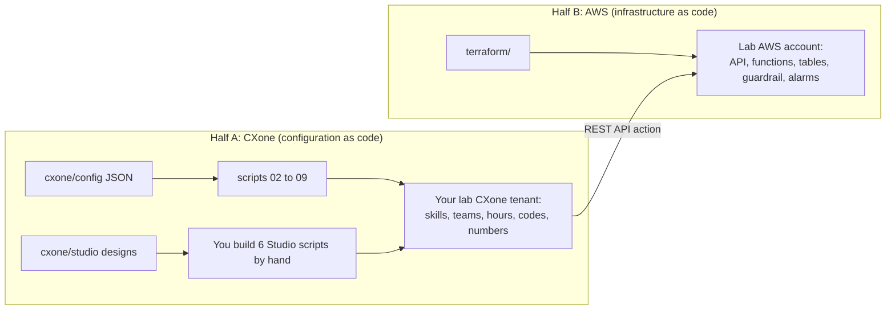

# Build manual: Kestrel Insurance on NICE CXone

How to build the lab, step by step, and why each step exists. Written so you can follow it when you are tired. Every step has **You should see**, so you know it worked before you move on.

> **Safety first.** Use a **lab** CXone tenant and a **lab** AWS account. **Never** run any of this against a customer's tenant or account. Everything here is fictional.

---

## Part 0. What you are building

Two halves that talk to each other.



| Half | Tool | Changes | Time |
|---|---|---|---|
| B. AWS | OpenTofu (or Terraform) | Creates cloud resources in your lab account | 30 minutes |
| A. CXone settings | Bash or PowerShell scripts | Creates skills, teams, hours, codes, points of contact in your lab tenant | 20 minutes |
| A. Studio scripts | You, by hand, from the designs | Six call flows | 3 to 4 hours |

**Why two tools?** There is an official way to build AWS from code. I found no official Terraform provider for CXone. So CXone is set up by scripts that read reviewed data files. The scripts only **add** things, and only **delete** things they added.

---

## Part 1. Before you start

### 1.1 What you need

| Need | Detail | Notes |
|---|---|---|
| A CXone **lab** tenant | A sandbox from NICE, a partner, or your employer's training tenant | There is no self-service free tier that I know of (verify). If you do not have one, you can still do Half B and read the designs |
| A CXone **API user and access key** | Created by a tenant administrator | Least privilege: only the admin areas the scripts use |
| An AWS **lab** account | With a budget alarm set | See `docs/OPERATIONS-COST-CLEANUP.md` |
| A computer | Windows, macOS or Linux | Windows users: PowerShell 5.1 or 7 |
| GitHub account | To store the code | Optional |

### 1.2 Install the tools

Use the runbook for your system. It installs and checks everything:

- Windows: `docs/RUNBOOK-POWERSHELL.md`, Step 1
- Linux, macOS, WSL: `docs/RUNBOOK-BASH.md`, Step 1

You need: Git, Python 3.12 or newer, OpenTofu (or Terraform), the AWS CLI, `jq` and `curl` (Bash only), and PowerShell on Windows.

---

## Part 2. Get your keys (and keep them safe)

### 2.1 CXone access key

1. Ask your tenant administrator for an **API user** limited to what the scripts need (read and create for skills, teams, hours of operation, dispositions, unavailable codes, points of contact; update on hours of operation for the CAT switch; delete only on the same objects).
2. They create an **access key** for that user. It has an **ID** and a **secret**. The secret is shown once.
3. Save both in your password manager.
4. You also need your **tenant name** exactly as CXone knows it.

Screen names in CXone change between releases. If a screen differs from what is written here, follow the intent: *a named API user, an access key, least privilege*.

### 2.2 AWS login

Use SSO if you can: `aws sso login --profile lab`. Otherwise short-lived keys. Do not create long-lived keys for yourself.

### 2.3 The one rule about secrets

Secrets live in **environment variables for the current window only**. Not in files. Not in chat. Not in screenshots. The scripts read them and never print them. The repo checker fails if it finds a secret-shaped string.

---

## Part 3. Get the code

```text
git clone https://github.com/<you>/nice-cxone-enterprise-insurance-lab.git
cd nice-cxone-enterprise-insurance-lab
```

Folder tour (read once):

| Folder | What it is |
|---|---|
| `cxone/config/` | The CXone setup as data |
| `cxone/studio/` | The six Studio designs |
| `cxone/endpoints.json` | Every CXone API path, each unverified until you test |
| `terraform/` | AWS code. `envs/` has `minimal`, `full`, `nonprod` |
| `app/` | The functions and their tests |
| `scripts/bash/`, `scripts/powershell/` | The scripts, one language each |
| `migration/`, `governance/`, `carrier/` | The migration pack and the rulebook |

---

## Part 4. Tell the scripts who you are

Follow Step 3 of your runbook. In short, set these names in your window (values are yours):

| Name | What |
|---|---|
| `CXONE_TENANT_ID` | Your tenant name |
| `CXONE_ACCESS_KEY_ID` | The access key ID |
| `CXONE_ACCESS_KEY_SECRET` | The access key secret |
| `AWS_PROFILE` and `AWS_REGION` | Your lab AWS login (region `ap-southeast-2`) |

---

## Part 5. Half B: build the AWS side

Do this first, because the Studio scripts need its address.

### Step B1. Offline checks (nothing is changed)

Script `10-aws-validate`. **You should see:** `All checks passed.`, the unit tests passing, `Formatting is clean`, `Configuration is valid`.

*Why:* never apply code that has not passed its own checks.

### Step B2. Plan

Script `11-aws-plan` with `minimal`. **You should see:** a long list and `Plan: N to add, 0 to change, 0 to destroy.` Read it. Names start with your prefix.

*Why:* a plan is a promise of what will happen. Read it before you agree.

### Step B3. Apply

Script `12-aws-apply` with `minimal`. It asks you to type `YES`. **You should see:** `Apply complete! Resources: N added.`

*Why:* apply uses the saved plan, so what you read is what runs.

### Step B4. Load the fictional data

Script `13-aws-seed`. **You should see:** `Loaded 4 items into policies`, `Loaded 3 items into claims`, `Loaded 3 items into cat_events`.

### Step B5. Smoke test

Script `14-aws-test-api`. **You should see:** `Passed 12, failed 0.` and `All smoke tests passed.`

This checks: right and wrong verification, the same answer for a made-up policy, bad input refused, claim status, storm lookup, case created then duplicate, card number refused, attack phrase blocked.

### Step B6. Health

Script `05-health-check`. **You should see:** `HTTP 200`, `"status": "ok"`, `Integration layer healthy`.

Write down the **API address** (`tofu output -raw api_url`) and keep the **API key** in your password manager (`tofu output -raw api_key_value`). Never paste it into chat or a file in the repo.

### Optional: the full environment

`full` adds the firewall, the guardrail, the dashboard and (if you set a model) generative answers. The firewall allow-list is empty by default, which means **nobody** can call the API: get the platform's public address ranges from NICE or your carrier, and put them in a local, untracked tfvars file.

---

## Part 6. Half A: build the CXone settings

### Step A1. Preflight (nothing is changed)

Script `00-preflight`. **You should see:**

```text
== Tools
OK  curl found
OK  jq found
OK  python3 found
OK  git found
== CXone login
OK  Token received for tenant <your tenant>
OK  Admin API reachable (your tenant has N skills)
```

**Check the tenant name is your lab.** If not, close the window.

### Step A2. Check the API paths

Script `01-verify-endpoints`. **You should see:** `OK` for skills, teams, hoursOfOperation, dispositions, unavailableCodes, pointsOfContact, campaigns.

*Why this step exists:* the paths were written from the documentation pattern and have **never been run against a real tenant**. If one fails, fix `cxone/endpoints.json` (not the scripts), then run it again.

The create, update and delete paths cannot be checked without changing something. They are first proven by the apply in a lab tenant. Treat the first apply as a test.

### Step A3. Plan

Script `03-cxone-plan`. **You should see:** `Plan: 53 to create, 0 already exist.` (11 skills, 12 teams, 5 hours profiles, 9 dispositions, 8 unavailable codes, 8 points of contact, plus team skills and holidays.)

### Step A4. Apply (this changes your lab tenant)

Script `04-cxone-apply`. It asks you to **retype the tenant name**, then type `YES`. **You should see:** `Created 53, already existed 0, failed 0.`

If something fails, read the last `WARN` line. Fix the cause and run it again. It only adds what is missing.

### Step A5. Inventory

Script `02-cxone-inventory`. **You should see:** counts of lab objects (53 in total) and the list of points of contact.

*Why every object carries a marker:* each created object gets `[kestrel-lab]` in its description. Destroy refuses to touch anything without it.

---

## Part 7. Build the six Studio scripts

Studio scripts are drawn on a canvas, so this part is by hand. Each design file tells you exactly what to drop on the canvas. Work in a **development** stage in your lab tenant.

### 7.1 How to read a design file

```yaml
nodes:
  call_verify:            # the step's name
    type: RestApi         # which Studio action to use
    operation: policyVerify   # which API operation (see openapi/)
    timeoutSeconds: 6     # set this on the action
    failMode: closed      # what the script does if the call fails
    request: {...}        # what to send
    branches:             # where to go next
      ok: eval
      error: fail_path
    why: >                # why it is like this
```

### 7.2 Action map

| Design `type` | Studio action (intent) | Notes |
|---|---|---|
| Begin | Begin | Every script starts here |
| Hours | Hours | One branch each for open, closed, holiday, emergency |
| Run | Call another script | Pass parameters; the sub-script returns values (check your release's action name) |
| Play | Play | Text-to-speech or a recording |
| Menu | Menu | Keep to 4 or 5 options. Always set timeout and invalid paths |
| Capture | Capture (keypad) | `mask: true` means mark it sensitive, no logging |
| Case | Case | Always set a default branch |
| Snippet | Snippet | Small calculations such as incrementing a counter |
| RestApi | REST API | Set timeout, URL, key header, body. Studio default timeout is 10 seconds; do not exceed the design |
| Reqagent | Request agent (queue) | Set skill, priority, timeout, and the timeout path |
| QueueCallback | Queue callback | Offers a callback |
| Hangup / Return | End the call / return to the caller script | |

### 7.3 Build order

1. `verify_caller` (smallest; used by others)
2. `cat_surge`
3. `care_path`
4. `claims_self_service`
5. `ai_assist` (build it, but leave the AI path switched off until the guardrail is deployed and tested)
6. `front_door` (last: it calls the others)

For each script: create it, drop the actions, set the settings from the design, wire the branches, **run the Studio checker/validate**, save, then attach `front_door` to **all eight** points of contact. Each one passes its own `brandName` and `line` (the values are in `cxone/config/points_of_contact.json`). The CAT hotline and the care line use `line = cat` and `line = care`, which send them straight to the `cat_surge` and `care_path` scripts.

### 7.4 Put the API address and key into Studio

In the REST API action, set the URL to `<api_url>/policy/verify` (and so on, per `openapi/`), and add the header `x-api-key`. Store the key in the platform's secret or variable store, never in the script text. (Verify what your tenant offers for secrets.)

### 7.5 Export and keep

Export each finished script and commit the export to a **private** place. The designs say what you meant; the exports are what ran.

---

## Part 8. Testing

### 8.1 Run the automated tests

| Test | Command | You should see |
|---|---|---|
| Repo checks | `python3 tools/check_repo.py` | `All checks passed.` |
| Function tests | `python3 -m pytest app -q` | `87 passed` |
| Checker self-tests | `python3 -m pytest tools -q` | `18 passed` |
| AI prompts (local layer) | `python3 tools/run_ai_eval.py` | `13 passed, 0 failed, 9 skipped (not run)` |
| Scripts on a mock | `bash scripts/tests/test_cxone_scripts.sh bash` | `Passed 45, failed 0.` |

The nine skipped AI prompts need the real guardrail. After a `full` deployment, run `python3 tools/run_ai_eval.py --url <api_url>` with `KESTREL_API_KEY` set in your window.

### 8.2 Phone tests

Use the list in `migration/test-plan.csv`. For each case: do the steps, compare to *expected*, keep the *evidence*. Start with the cases marked wave 1, then wave 2.

---

## Part 9. Break it on purpose

You learn more from breaking it than from watching it work.

| Break | Expect |
|---|---|
| Use a wrong key | `403` from the API |
| Type a wrong postcode three times, then correctly | Same message every time; lock after the limit |
| Stop the API (or change its address in Studio) and call the verify path | Not verified; routed to a person |
| Stop the API and call the claim lodgement path | Still queues (fail open) |
| Say "ignore all previous instructions" to the AI path | Blocked; offered a person |
| Remove the timeout from a queue step in a design | `check_repo.py` fails |

---

## Part 10. The catastrophe drill

1. Script `06-cat-mode status`. **You should see:** `Emergency flag now: false`.
2. Script `06-cat-mode on`. Type `ON`. **You should see:** `CAT mode is now on at <time>`.
3. Make a live call. **You should hear** the event message first, then the CAT queue.
4. Script `06-cat-mode off`. Type `OFF`. Make a live call again.

---

## Part 11. Tear it down

1. CXone: script `09-cxone-destroy`. It lists exactly what it will delete (only lab-marked objects named in the config) and asks you to type `DESTROY`. **You should see:** `Destroyed.`
2. AWS: script `19-aws-destroy`. Type `DESTROY`.
3. Remove Studio scripts and point of contact bindings you made by hand.
4. Check the AWS billing console and your CXone contract for anything that remains.

---

## Part 12. When something fails

| What you see | Meaning | Fix |
|---|---|---|
| `Set CXONE_TENANT_ID first` | Variable not set in this window | Part 4 |
| `Tenant lookup failed` | Wrong tenant name | Check spelling |
| `Could not get a token (HTTP 401)` | Wrong key or secret | Re-check Part 2 |
| `HTTP 404 ... /skills` | A path in `endpoints.json` is wrong | Run `01-verify-endpoints`, fix the file |
| `HTTP 403` on create | The API user lacks the permission | Ask the administrator |
| `HTTP 409` on create | The name exists | The script treats this as exists. Check descriptions |
| `Files are not formatted` | Formatting only | `tofu fmt -recursive` in `terraform` |
| Plan wants to destroy something | Code and account disagree | Do not apply. Find out why |
| `could not delete ... (in use)` | Something still uses the object | Remove the use, run again |

---

## Part 13. Put it on GitHub

1. `python3 tools/check_repo.py`: all checks passed.
2. `git init -b main`, `git add .`, then `git status`. **You must not see** `.tfstate`, `.tfplan`, `.env`, `backend.tf`, `terraform.tfvars` or an `evidence` folder.
3. Commit, add the remote, push.
4. In GitHub, check the **Actions** tab runs the checks.

---

## Part 14. The twelve decisions, in one line each (the "why")

1. CXone setup as data, because it can be reviewed and repeated.
2. Scripts add but never update or delete, because a script that edits the wrong thing is worse than none.
3. Lab marker on every object, so destroy cannot touch someone else's work.
4. Studio designs as text with a reason, because a picture cannot be reviewed.
5. REST layer on AWS with tests, because business rules belong where they can be tested and secured.
6. Contract first (OpenAPI), because both sides must agree before either builds.
7. Two-factor verification with one answer, so the service cannot reveal which policies exist.
8. Safe-to-repeat writes, because Studio retries.
9. Fail closed for money and data, open for priority, decided per step.
10. A catastrophe switch that is a flag, because storms are no time to edit scripts.
11. AI behind a guard on both sides, with a person always available.
12. A checker that has been attacked, because a checker that never fails proves nothing.

---

## Part 15. What is not built yet

| Item | State |
|---|---|
| Studio scripts | Designed, not exported from a real tenant |
| Chained overflow queues | Callback after a timeout is used; overflow chains are a next step |
| NICE AI agent | Not built. The guard layer is built |
| Bedrock guardrail tests | Written; need a deployed guardrail to run |
| Full AWS `tofu validate` | Runs in CI (the AWS provider could not be fetched where this was built) |
| Real CXone API paths | Unverified until `01-verify-endpoints` passes on a real tenant |
| Second active region | Design only. Archive replication is the only DR copy built |
| Real payments, outbound, workforce and quality management | Out of scope |
