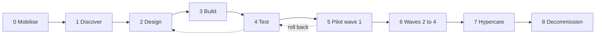
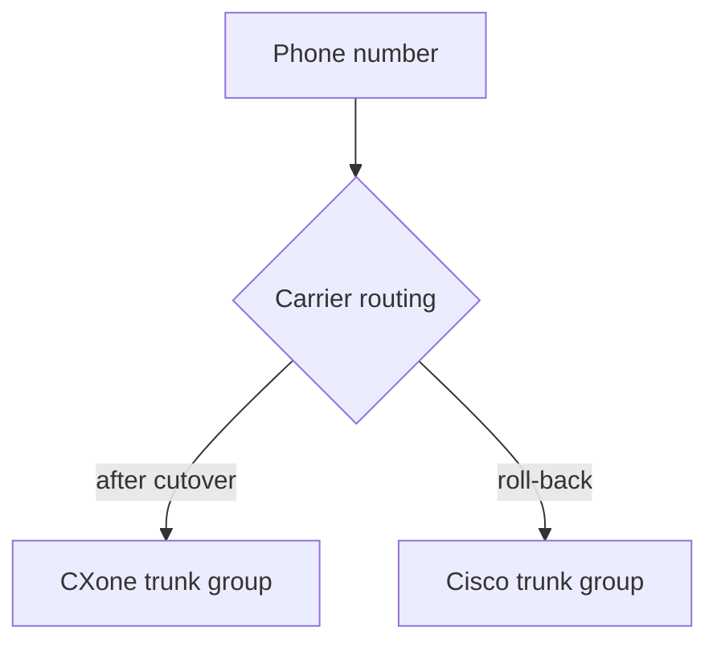

# Migration procedure: Cisco contact centre to NICE CXone

A step-by-step procedure for moving a large insurer's inbound contact centre from a Cisco platform to NICE CXone, with a telco carrier carrying the numbers. Lab material: the organisation, numbers and data are fictional. The working files are in `migration/`.

**Reading guide.** Each phase has: purpose, steps, deliverables, who does it, and the gate (the test you must pass to move on). If you read only one thing, read the gates.

---

## Phase 0. Mobilise

**Purpose:** agree who is doing what, with what authority, before touching anything.

1. Name the sponsor, the technical lead, the carrier manager, the vendor contacts, the risk and compliance contact, the operations manager, and the change manager.
2. Agree the decision rights in writing: who says go, who says no-go, who may roll back (the cutover lead, without a committee).
3. Agree the governance rhythm: weekly steering, daily stand-up during build, daily bridge during waves.
4. Start the compliance work now: the material service provider register entry, notification of the agreement if required, the data-location answers from every vendor, and the security assessment (see `governance/`).
5. Book carrier change windows for all four waves. Lead times are long.

**Deliverables:** RACI (`governance/raci.md`), governance calendar, register entry, risk register (`migration/risk-register.csv`).
**Gate:** sponsor signs the charter; carrier windows booked; compliance contact named.

---

## Phase 1. Discover

**Purpose:** find everything the old platform does, including what nobody remembers.

### 1.1 Confirm the source

Ask first: **is the Cisco source the classic stack (UCCE/CVP/Finesse/CUCM/CUBE) or Webex Contact Center?** The discovery tools differ. Do not assume.

### 1.2 Inventory (the list that prevents Monday-morning incidents)

| Inventory | How | Lands in |
|---|---|---|
| Numbers: every inbound number, where it points, volume by hour | Carrier records; routing config; call detail records | `migration/number-inventory.csv` |
| Call flows and IVR apps | Export scripts; read; **observe live calls** | Flow register |
| Queues, skills, agent groups and members | Export | Skills and teams design |
| Hours, holidays, emergency flags | Export; ask the business | `cxone/config/hours.json` |
| Reason and wrap-up codes | Export | Dispositions |
| Integrations: databases, CRM, web services, CTI, screen pop | Interviews, network captures, vendor lists | Integration register |
| Agent desktop gadgets and custom tools | Ask agents | Gadget register |
| Reports and who reads them | Report catalogue; ask consumers | Report register |
| Recording rules and retention | Policy; config | Recording design |
| Outbound and campaigns | Config | Out of scope unless agreed |
| Workforce management and quality tools | Interviews | Integration register |
| Network: agent sites, home workers, bandwidth, QoS | Site surveys | Network plan |
| Security: roles, access, logging, vendor access | Review | Security design |

### 1.3 Talk to people

- Floor supervisors: "what do you do that is not in the documentation?"
- The longest-serving agents: "what breaks?"
- Reporting analysts: "which numbers does the board see?"
- Compliance: "what must never change?"

**Deliverables:** the registers above, volumes by hour and day, a first list of unknowns.
**Gate:** every inbound number has an owner and a wave; every call flow has an owner; unknowns are in the risk register with owners.

---

## Phase 2. Design

**Purpose:** decide what the business needs, not how the old system did it.

1. Write requirements from the business point of view: "a storm victim reaches an agent within X minutes" rather than "queue priority 7".
2. Design hours profiles, skills, teams, dispositions (`cxone/config/`), and the call flows (`cxone/studio/`).
3. Design the integration contract (`openapi/`): what each call asks, what it returns, fail-open or fail-closed.
4. Design security, privacy and AI controls (`governance/`, brief section 7 and 8).
5. Design the cutover method: per-number carrier re-point, roll-back target, maximum roll-back time.
6. Write acceptance criteria per wave (`migration/waves.md`).

**Deliverables:** design set, API contract, acceptance criteria, test strategy.
**Gate:** business, risk and operations sign the design; a security review is done.

---

## Phase 3. Build

1. AWS side with OpenTofu (`terraform/`), then the CXone settings with the scripts (`scripts/`), then the Studio scripts by hand from the designs.
2. Build in a development stage and a lab account. Never in production.
3. Every change is peer reviewed. The repo checker and CI must pass.
4. Export Studio scripts and store them.
5. Configure recording, retention and the archive.
6. Configure alarms and the dashboard. Decide who gets paged.

**Gate:** CI green; peer review done; the build runs from a clean checkout using only the runbook.

---

## Phase 4. Test

Test in layers. Do not skip to the phone tests.

| Layer | What | Where |
|---|---|---|
| Unit | Each function behaves | `app/tests` (87) |
| Contract | Studio and the API agree | `openapi/`, Postman collection |
| Scripts | The deployment scripts do what they say | `scripts/tests` |
| Config | The settings match the design | `check_repo.py`, inventory |
| Call flow | Every menu, timeout, invalid key, holiday, failure | `migration/test-plan.csv` |
| AI | Fixed prompts, both layers | `evals/` |
| Security | Penetration test of the API edge; log search for personal data | Process |
| Load | At least 150% of the busiest hour in the last 12 months | Load plan |
| Failover | DR rehearsal | `governance/dr-and-bcp.md` |
| Roll-back | Re-point a test number back and time it | Carrier ticket |
| UAT | Real agents and supervisors on real tasks | Sign-off |

**Gate (wave 0 exit):** all non-live tests pass; roll-back rehearsed once and timed; training done for the pilot team.

---

## Phase 5. Pilot (wave 1): the CAT hotline

**Why this number:** low everyday volume, real carrier path, and it proves the storm switch.

1. Run the cutover runbook (`migration/cutover-runbook.md`). Go/no-go 30 minutes before.
2. Carrier re-points the number. Make a live test call from outside.
3. Hypercare for 5 business days (`migration/hypercare.md`).
4. Drill the CAT switch on the real number outside peak.
5. Review: what we saw, how long to notice, to decide, to act.

**Gate:** wave 1 exit criteria in `migration/waves.md`.

---

## Phase 6. Waves 2 to 4

Repeat the pilot method, with each wave's entry and exit criteria:

| Wave | Numbers | Special care |
|---|---|---|
| 2 | Servicing, Broker, Care | Business hours; brokers told in writing; care team lead on the floor |
| 3 | Claims, Assistance | 24x7 and high stakes; load test; DR rehearsal; no severe weather |
| 4 | Regional | Agent network checks |

**Change freeze rule:** no cutover when a severe weather warning is active for the window or the 48 hours after.

---

## Phase 7. Hypercare and handover

1. Daily stand-up, floor walkers, one dashboard, same-weekday comparison against the old platform.
2. Severity 1 defects are fixed or rolled back in hours.
3. Handover to business-as-usual: runbook, on-call roster, dashboards, alarm routing, monthly review (evals, cost, incidents, access review).
4. Sign-off by operations, risk and the sponsor against the exit criteria.

---

## Phase 8. Decommission (a separate decision)

Switching off Cisco is its own piece of work with its own approval. Before it:

- Old recordings: where will legal-hold access live?
- Old reports: exported and archived?
- Licences, support contracts and carrier trunks: end dates and notice periods.
- Roll-back no longer required: formal agreement.
- Security: remove access and certificates; wipe devices.
- Update the material service provider register and any required notifications.

---

## Cutover control: why the carrier is the switch

- Both directions are the same kind of change, so roll-back is real.
- The rehearsed roll-back time is part of the plan.
- Never change anything in the Cisco routing during hypercare unless it is part of the roll-back. A "quick fix" on the old side can break the way back.

---

## Parallel running: be exact

A number rings one place. "Parallel" can mean:

| Method | What it proves | Limit |
|---|---|---|
| Test numbers on the same trunks | Platform and routing work | Not real customers |
| Shadow sessions (agents work test calls on CXone while Cisco serves customers) | Agents can do the job | Not real volumes |
| Low-risk line first | Real calls, small blast radius | Only that line's behaviour |
| Report comparison (same day, both platforms) | Reports are comparable | Only for numbers served by both |

Say which one you did.

---

## Migration measures

| Measure | Definition | Why |
|---|---|---|
| Answer rate and abandon rate | Calls answered / offered; hang-ups before answer | Customer harm |
| Service level | Share answered within a target | Contract and promise |
| Average speed of answer | Mean wait | Customer harm |
| First-contact resolution | Share solved first time | Quality |
| Verification outcomes | Verified / not verified / locked | Breakage and attacks |
| Fail-closed counts | Times a step failed closed | Upstream health |
| Guard blocks | AI blocks per 1,000 questions | Rules too tight or attacks |
| Roll-backs | Count and time taken | Plan quality |
| Defects by severity | Open and closed | Readiness |

---

## Status report template (one page, weekly)

1. **Overall:** green, amber or red, and one sentence why.
2. **This week:** done.
3. **Next week:** planned.
4. **Decisions needed:** who, by when.
5. **Risks:** top 3 with owner and date.
6. **Wave status:** entry criteria met or not.
7. **Measures:** the table above.
